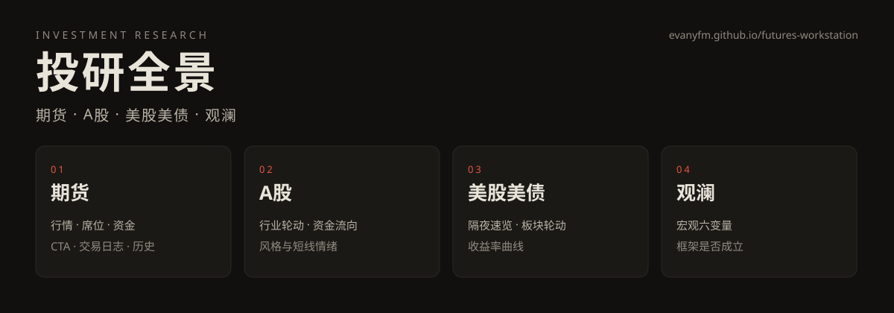

# 投研全景

  

纯静态站点：期货行情、席位、资金与 CTA，并接入 A股、美股美债和观澜。个人复盘数据存私有数据仓（futures-journal-data），不在此公开仓。

线上：https://evanyfm.github.io/futures-workstation/

当前模块：

- 期货：总览、品种详情、品种全景、CTA 评分、历史回看
- 交易日志
- A股仪表盘
- 美股美债
- 观澜（宏观六变量）

源码与更新：

- 源码与数据生产：EvanYFM/trading-system
- 更新方式：构建产物 push 到本仓 main，GitHub Pages 约 1 分钟自动上线
- 每日更新与发布检查：[`docs/daily-data-update-handoff.md`](docs/daily-data-update-handoff.md)

## A 股盘后更新

[执行任务书与换人交接清单](docs/ashare-daily-task.md)
